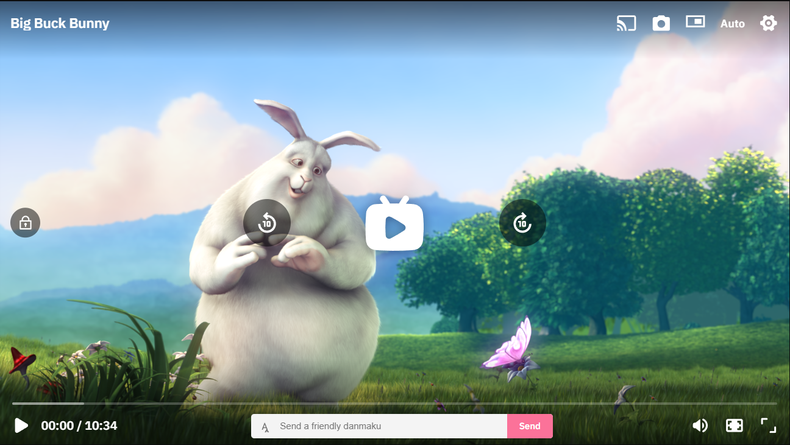

# NusaPlayer

[](https://github.com/namtxs/nusaplayer/actions/workflows/ci.yml)
[](LICENSE)
[](https://github.com/namtxs/nusaplayer)
[](https://pnpm.io)
[](https://www.typescriptlang.org/)
[](CONTRIBUTING.md)

HTML5 video player. Plugins for HLS, DASH, FLV, danmaku, playlist, and React.

[Docs](https://nusaplayer.vercel.app/) · [Playground](https://nusaplayer.vercel.app/playground/) · [Streams](https://nusaplayer.vercel.app/player/)

[](https://nusaplayer.vercel.app/)

```js
import Player from '@nusaplayer/core'
import ui from '@nusaplayer/ui'

Player.make('#player', {
  lang: 'id',
  source: { src: 'https://vjs.zencdn.net/v/oceans.mp4' }
})
  .use([ui()])
  .create()
```

```html
<script src="https://cdn.jsdelivr.net/npm/@nusaplayer/core@latest/dist/index.min.js"></script>
<script src="https://cdn.jsdelivr.net/npm/@nusaplayer/ui@latest/dist/index.min.js"></script>
<script>
  NusaPlayer.make('#player', {
    source: { src: 'https://vjs.zencdn.net/v/oceans.mp4' }
  })
    .use([NusaUI()])
    .create()
</script>
```

Pass plugins to `.use([...])`. After `.create()` they are on `player.context`.

## Features

- HLS, DASH, FLV / MPEG-TS, WebTorrent, Shaka
- Controls, theme, screenshot, PiP, fullscreen
- Keyboard shortcuts, captions (SRT / WebVTT), thumbnails
- Playlist, Chromecast, AirPlay, ads, danmaku
- Fallback URLs when a stream fails
- Indonesian and other UI languages
- React wrapper

## Packages

| Package | Role |
| --- | --- |
| `@nusaplayer/core` | engine |
| `@nusaplayer/ui` | controls |
| `@nusaplayer/hls` | HLS (`hls.js`) |
| `@nusaplayer/dash` | DASH (`dash.js`) |
| `@nusaplayer/mpegts` | FLV / MPEG-TS |
| `@nusaplayer/shaka` | Shaka |
| `@nusaplayer/torrent` | WebTorrent |
| `@nusaplayer/danmaku` | danmaku |
| `@nusaplayer/plugins` | playlist, Cast, AirPlay, ads, VTT thumbs |
| `@nusaplayer/react` | React |
| `@nusaplayer/full` | UMD bundle (core + ui + loaders) |

UMD globals: `NusaPlayer`, `NusaUI`, `NusaHls`, `NusaDash`, `NusaMpegts`, `NusaShaka`, `NusaTorrent`, `NusaDanmaku`.

## Develop

```bash
pnpm i
pnpm run build
pnpm run dev:exam
```

Standalone demo: http://localhost:5173/

```bash
pnpm --filter=@nusaplayer/docs start
```

Local docs: http://localhost:3000/ · live: [nusaplayer.vercel.app](https://nusaplayer.vercel.app/)

| | |
| --- | --- |
| [`/`](https://nusaplayer.vercel.app/) | live player |
| [`/docs`](https://nusaplayer.vercel.app/docs/) | manual |
| [`/playground`](https://nusaplayer.vercel.app/playground/) | samples |
| [`/player`](https://nusaplayer.vercel.app/player/) | stream tester |

| Command | |
| --- | --- |
| `pnpm run build` | packages (except docs) |
| `pnpm run build:docs` | docs site |
| `pnpm run test` | Vitest |
| `pnpm run lint` | Prettier |

See [CONTRIBUTING.md](CONTRIBUTING.md).

## License

[MIT](LICENSE)
